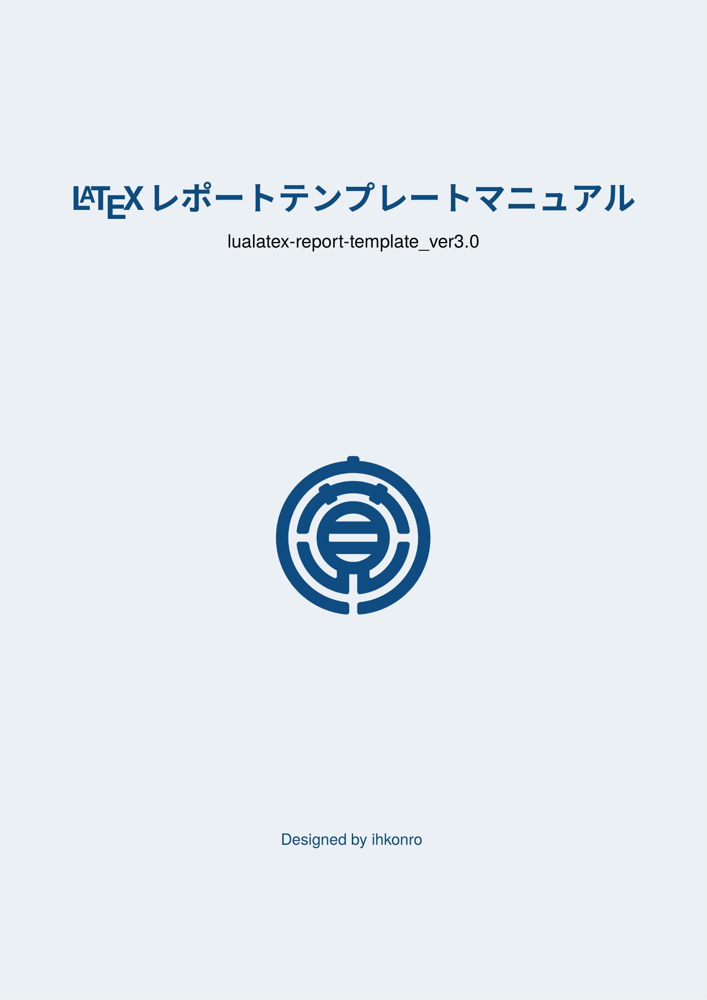
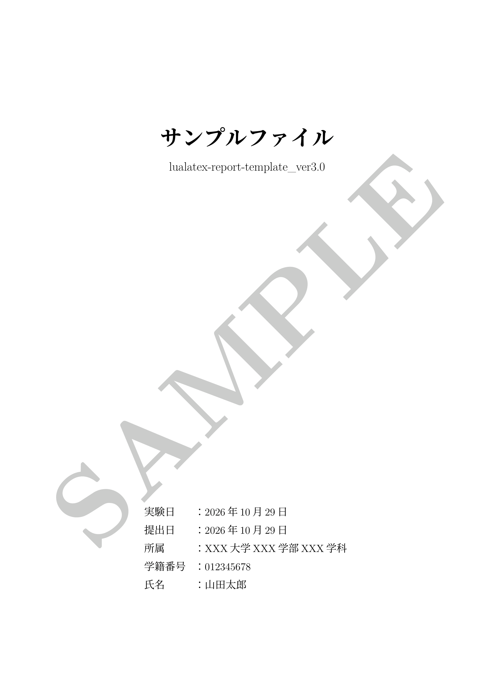
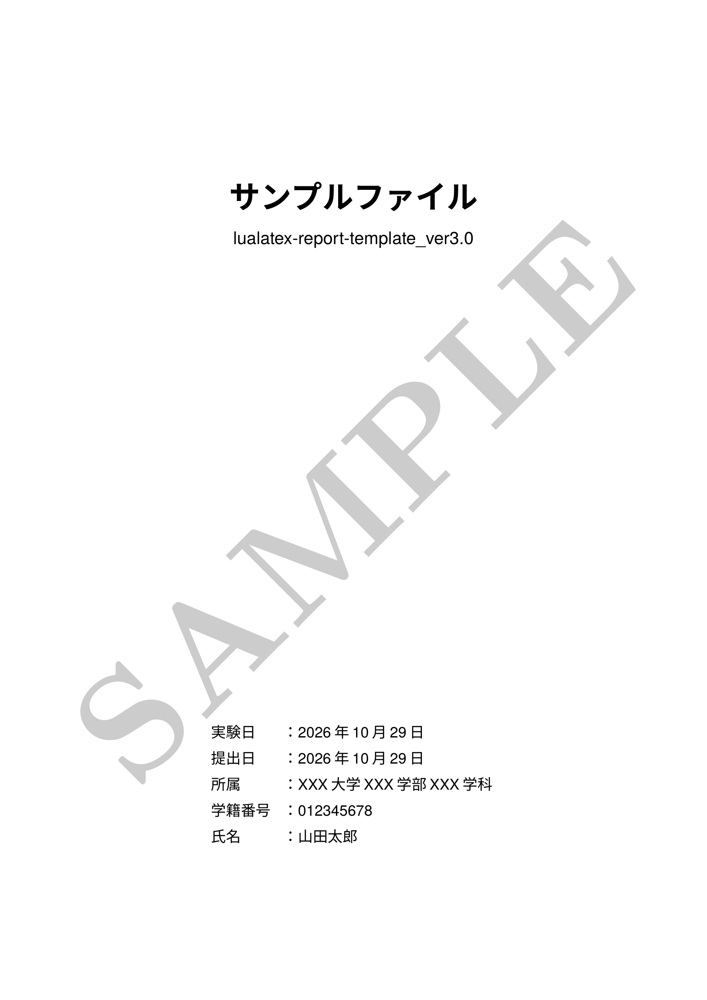
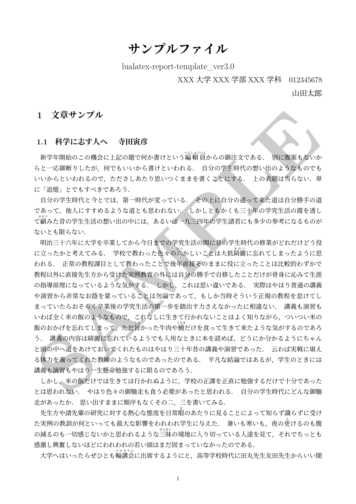
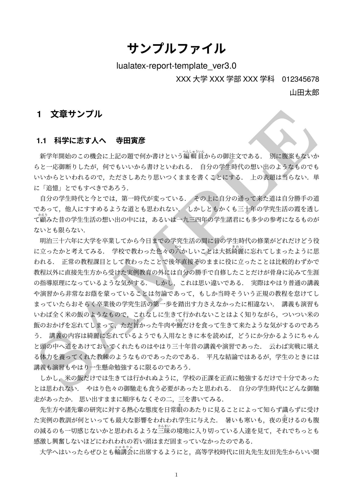

# LaTeXレポートテンプレート
PDF版マニュアルは以下から閲覧・ダウンロードできます。

| マニュアル |
| :---: |
| [](manual/lualatex-report-template_ver.3.0_manual.pdf) |
|  [ダウンロード](https://raw.githubusercontent.com/ihkonro/latex-report-template-dist/master/manual/lualatex-report-template_ver.3.0_manual.pdf) |

LuaLaTeXを用いて、日本語のレポートを作成するためのテンプレートです。

表紙・目次の有無や、タイトル・見出しのフォントを切り替えられます。普段の課題からフォーマルなレポートまで、用途に応じて利用できます。

## 特徴

- **2種類のレイアウト**：表紙・目次のある「ノーマル版」と、本文から始まる「シンプル版」
- **2種類のフォントスタイル**：タイトル・見出しをゴシック体または明朝体に変更可能
- **ファイルの分割管理**：本文・設定・画像・参考文献を分けて管理可能
- **2つの利用環境に対応**：ローカル環境とCloud LaTeXで利用可能

## 完成見本

各スタイルの仕上がりは、以下のPDFで確認できます。

| `normal-rmmc` | `normal-sfgt` | `simple-rmmc` | `simple-rmmc` |
| :---: | :---: | :---: | :---: |
| [](sample/sample-normal-rmmc.pdf) | [](sample/sample-normal-sfgt.pdf) | [](sample/sample-simple-rmmc.pdf) | [](sample/sample-simple-sfgt.pdf) |
| [ダウンロード](https://raw.githubusercontent.com/ihkonro/latex-report-template-dist/master/sample/sample-normal-rmmc.pdf) | [ダウンロード](https://raw.githubusercontent.com/ihkonro/latex-report-template-dist/master/sample/sample-normal-sfgt.pdf) | [ダウンロード](https://raw.githubusercontent.com/ihkonro/latex-report-template-dist/master/sample/sample-simple-rmmc.pdf) | [ダウンロード](https://raw.githubusercontent.com/ihkonro/latex-report-template-dist/master/sample/sample-simple-sfgt.pdf) |

| ファイル | レイアウト | タイトル・見出し |
|:---|:---|:---|
| `sample-normal-rmmc.pdf` | ノーマル版（表紙・目次あり） | 明朝体・セリフ体 |
| `sample-normal-sfgt.pdf` | ノーマル版（表紙・目次あり） | ゴシック体・サンセリフ体 |
| `sample-simple-rmmc.pdf` | シンプル版（表紙・目次なし） | 明朝体・セリフ体 |
| `sample-simple-sfgt.pdf` | シンプル版（表紙・目次なし） | ゴシック体・サンセリフ体 |

## 使い方

### 1. テンプレートのダウンロード
テンプレートを利用する場合は、GitHub Releases から最新版テンプレートのZIPファイルをダウンロードしてください。

ダウンロードしたZIPファイルをCloud LaTeXにアップロードして利用できます。

※ リポジトリの「Code $\to$ Download ZIP」からダウンロードできるZIPファイルには、テンプレート以外のファイルも含まれています。Cloud LaTeXで利用する場合は、GitHub Releasesの配布ファイルを使用してください。

### 2. タイトルと著者情報の設定

`main.tex` を開き、タイトルや著者名などの情報を編集します。

タイトル（`\title`）と著者名（`\author`）は必ず設定してください。

### 3. スタイルの選択

`main.tex` の「スタイル選択」セクションで、フォントとレイアウトを設定します。

#### タイトルスタイル

`\newcommand{\titleStyle}{1}` の数値を変更します。

| 設定値 | スタイル | 説明 |
|:---:|:---|:---|
| `1` | `normal` | 表紙・目次あり |
| `2` | `simple` | 表紙・目次なし |

#### フォントスタイル

`\newcommand{\fontStyle}{1}` の数値を変更します。

| 設定値 | スタイル | 説明 |
|:---:|:---|:---|
| `1` | `sfgt` | タイトル・見出しがゴシック体・サンセリフ体 |
| `2` | `rmmc` | タイトル・見出しが明朝体・セリフ体 |

それぞれ独立して設定できるため、用途や好みに合わせて組み合わせられます。

### 4. 本文の執筆

`contents/body.tex` にレポート本文を記述します。

本文を複数のファイルに分けたい場合は、`contents/` 内に `.tex` ファイルを作成し、`main.tex` の本文セクションに次のように追記してください。

```latex
\input{contents/ファイル名.tex}
```

画像を挿入する場合は `figures/`、CSVファイルなどのデータを管理する場合は `data/` を利用してください。

### 5. 参考文献の設定

参考文献を使用する場合は、`main.tex` の「参考文献」セクションで、利用する方式に応じた設定を有効にしてください。

- **thebibliography環境**：`contents/reference.tex` に参考文献を記述し、対応する `\input` を有効にします。
- **BibLaTeX**：文献データベースなどを適切に設定し、`\printbibliography` を有効にします。

使用する方式に合わせて設定し、不要な方式は無効にしてください。

### 6. コンパイル

ファイルを保存し、LuaLaTeXでコンパイルします。VS CodeとLaTeX Workshopを使用する場合は、リポジトリに含まれるビルド設定を利用できます。

コンパイルが成功したら、生成されたPDFを開き、レイアウトや数式、図表などを確認してください。

## Cloud LaTeXでの使い方

ローカル環境を用意せずに、Cloud LaTeXでも利用できます。

1. 上記「テンプレートのダウンロード」を参考にZIP形式でダウンロードします。**ZIPファイルは解凍しません。**
2. Cloud LaTeXにログインします。
3. 「新規プロジェクト」から、ZIPファイルを使用してプロジェクトを作成します。以下の項目を設定してください。
   - 「ZIPファイルを選択」
   - プロジェクト名：任意
   - 説明：任意
   - LaTeXエンジン：lualatex
4. プロジェクトのファイル一覧から `.latexmkrc` と `settings.json` を削除します。これらは本テンプレートのローカル開発環境向けの設定ファイルです。
5. コンパイルを実行します。
6. コンパイルが成功したら、上記の「使い方」に従って `main.tex` や `contents/body.tex` を編集します。

※ Cloud LaTeXの画面や操作名称は、サービスの仕様変更によって異なる場合があります。

## ディレクトリ構成

```text
.
├── main.tex              # メインファイル
├── .latexmkrc            # latexmkの設定
├── settings.json         # VS Code用のビルド設定
├── contents/             # 本文・参考文献
│   ├── body.tex          # レポート本文
│   └── reference.tex     # 参考文献
├── data/                 # CSVなどのデータ
├── figures/              # 挿入画像
├── settings/             # 各種設定ファイル
│   ├── base.sty          # パッケージ・マクロの定義
│   ├── title.sty         # タイトル・見出しデザイン
│   └── config.tex        # レイアウト設定
└── out/                  # PDF・中間ファイルの出力先
```

### 主なファイルの役割

| ファイル | 役割 |
|:---|:---|
| `main.tex` | タイトル情報、スタイル選択、各ファイルの読み込み |
| `contents/body.tex` | レポート本文 |
| `contents/reference.tex` | `thebibliography`環境を使用する場合の参考文献 |
| `settings/base.sty` | パッケージの読み込み、独自コマンドの定義 |
| `settings/config.tex` | 余白などのレイアウト設定 |
| `settings/title.sty` | タイトル・見出しのデザイン |
| `.latexmkrc` | `latexmk`の動作設定 |
| `settings.json` | VS Code・LaTeX Workshop用のビルド設定 |
| `data/` | CSVファイルやソースコードなど |
| `figures/` | 挿入する画像ファイル |
| `out/` | 生成されたPDFや中間ファイル |

## 開発環境

- **OS**: Windows11
- **TeX Distribution**: TeX Live 2025
- **Engine**: LuaLaTeX
- **Editor**: Visual Studio Code
- **Extension**: LaTeX Workshop

## 注意事項

- すべてのファイルはUTF-8で保存してください。
- ファイル名には、日本語や空白をなるべく使用しないでください。
- 初回のコンパイルには時間がかかる場合があります。
- PDFを外部ビューアで開いたまま再コンパイルすると、環境によっては失敗する場合があります。
- コンパイルエラーが発生した場合は、ログを確認し、ファイル名・パス・設定を見直してください。

## 更新履歴

- **Ver. 1.0.0（2026-03-04）**
  - 初版を公開。
- **Ver. 2.0.0（2026-03-06）**
  - テンプレートを一元化し、拡張性を向上。
  - Gitサブモジュールに対応。
- **Ver. 2.0.1（2026-03-07）**
  - バグを修正。
- **Ver. 2.0.2（2026-04-07）**
  - バグを修正。
- **Ver. 3.0.0（2026-10-22）**
  - テンプレートを改良。
  - Gitサブモジュールを廃止。
- **Ver. 3.0.1 (2026-10-28)**
  - パッケージの追加および削除。
  - レイアウトの一部変更